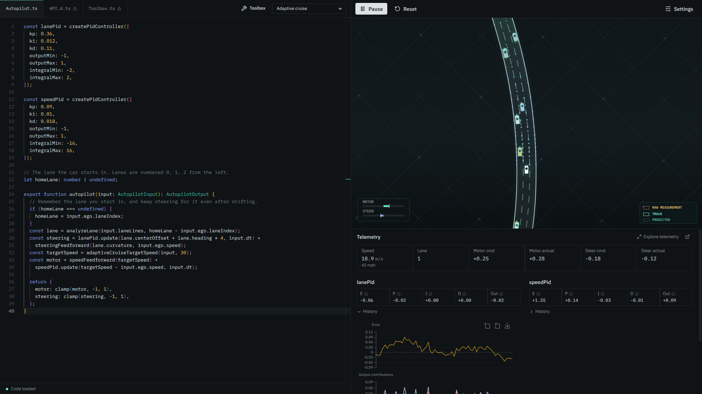
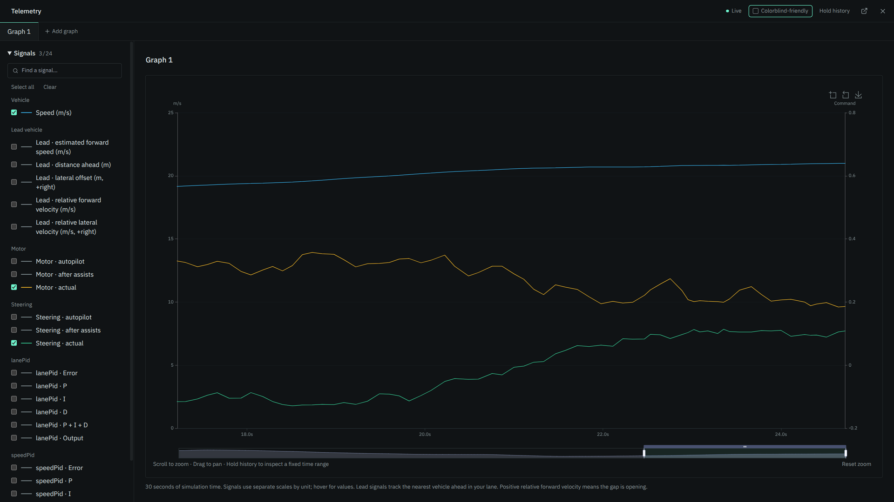
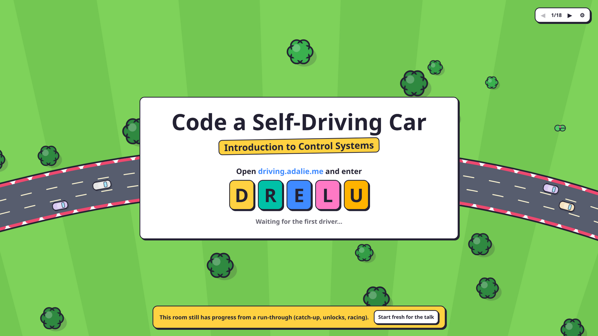
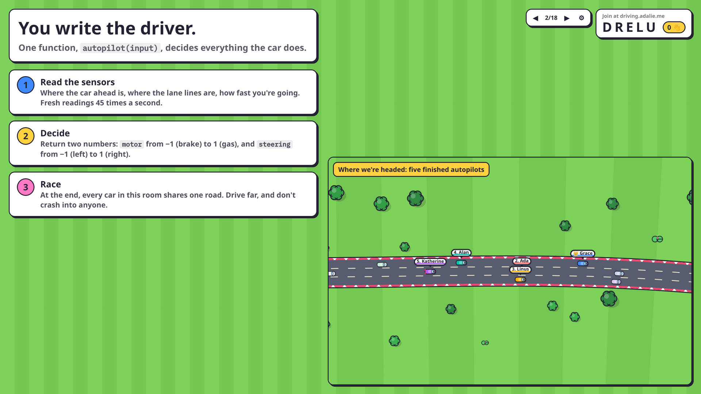
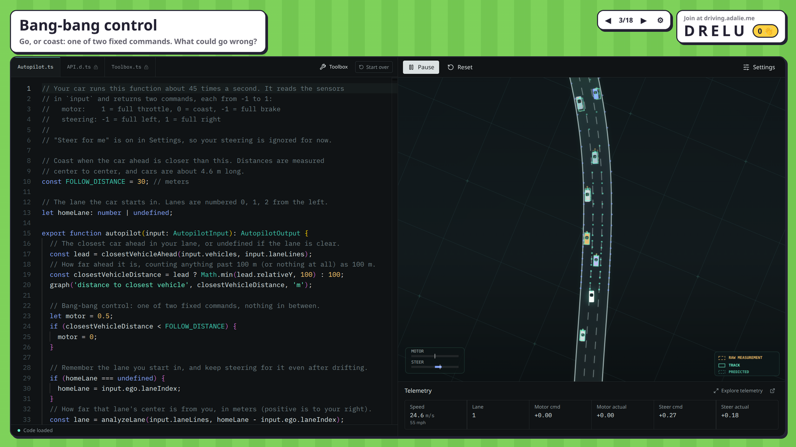
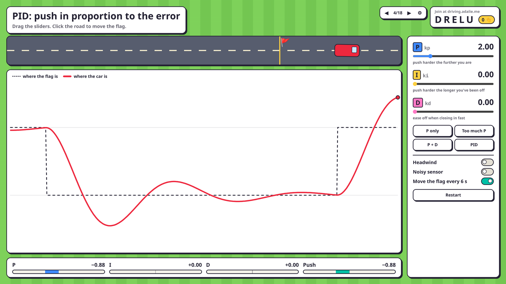
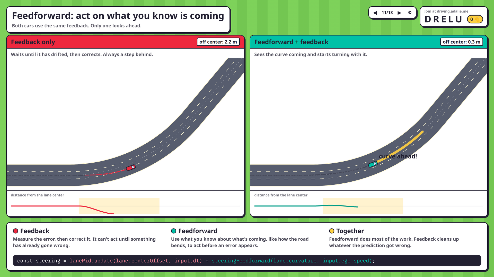

# Self-Driving Playground

A web-based PID control playground for a top-down self-driving highway simulation. Users edit TypeScript autopilot code in a VS-Code-like editor and immediately see how the controller behaves with noisy sensors, traffic, assist overrides, and imperfect actuation.



## Screenshots

### Playground

The solo playground lives at `/playground`. **Explore telemetry** opens a fullscreen graph workspace for speed, lead vehicle, motor, steering, and PID signals.



### Presentation

`/presentation` is an 18-slide talk deck, "Code a Self-Driving Car: Introduction to Control Systems". It hosts a race room, so the audience joins with the room code shown on the slides and races their own autopilots at the end. Arrow keys, Space, and clicker PageUp/PageDown move between slides.

| | |
| --- | --- |
|  |  |
|  |  |



## Run

```bash
npm install
npm run dev
```

Build check:

```bash
npm run build
```

Cloudflare Workers preview and deployment:

```bash
npx wrangler login
npm run preview:cloudflare
npm run deploy:dry-run
npm run deploy
```

The Workers config in `wrangler.jsonc` serves the Vite build as static assets with single-page-app fallback, routes `/api/*` to the Worker first, and binds the `Room` Durable Object used for multiplayer. `npm run deploy` builds before deploying.

To hide the join screen's "Practice on your own instead" link (for example during a talk), set `HIDE_PRACTICE_LINK` to `true` on the Worker. Use a secret so deploys keep it: `npx wrangler secret put HIDE_PRACTICE_LINK`, or add it as a secret under the Worker's settings in the Cloudflare dashboard. Plain dashboard variables are replaced on every `wrangler deploy`. The app reads it from `/api/config`, so no rebuild is needed. Delete the secret to bring the link back.

Headless traffic/personality report:

```bash
npm run traffic:report -- --density 0.9 --runs 3 --seconds 90 --warmup 15 --start-speed 24
```

This runs built-in traffic outside the user-code runner and reports traffic wave strength, speed spread, physical clearance, lane-keeping quality, assigned-lane exits, road exits, flow, collision events, hard braking events, lane changes, and per-personality behavior. Use `--noisy-lanes`, `--noisy-vehicles`, `--actuator-variation`, or `--json` for alternate test modes.

## Multiplayer Races

Open `/host` on the presenter screen. It creates a room and shows a five-character code. Players open the site root `/` (or `/play/CODE`), enter the code and a display name, then use the normal editor and simulator to practice. **Submit to race** sends the current code once it compiles locally. The solo playground, with every example, lives at `/playground`.

Inside a room, players start from the talk starter (bang-bang motor control with **Steer for me** on) and only see that one example, with a **Start over** button to get back to it. Their code and settings are saved separately from the solo playground. Under **Host controls → Player toolbox**, the presenter chooses which toolbox helpers players can see; changes reach every player immediately. New rooms start with Adaptive Cruise, Fastest Lane and Lateral Velocity Steering locked. Locking only hides a helper from the menu and the Toolbox.ts tab; drivers that already call it keep working.

- The presenter's browser is authoritative. It compiles every submission and runs each player's driver in its own sandboxed iframe and worker, steps one shared simulation, and scores rounds. Other players never receive anyone's source.
- Every submission is test-driven on the server before it reaches the presenter (see **Submission validation** below). The button shows **Validating…** meanwhile; hover it for the result.
- Rounds restart automatically (default 90 s race, 12 s break, adjustable under **Host controls**). Each round uses a new seed and a shuffled starting grid. A player's latest successfully compiled version races until they submit another. New versions take over at the next round, and a version that fails to compile leaves the previous one racing.
- Score per round = meters driven − 150 per collision the player caused − 25 per collision they were involved in. Causing a collision also cuts throttle for 1.5 s. Fault goes to the follower in a rear-end, to a car that cuts in sharply, and in side contacts to the car moving sideways (or drifted farther from its lane). The leaderboard ranks total points across rounds and also shows each player's best round.
- A driver that exceeds its 28 ms budget for 30 consecutive steps coasts for the rest of the round. Runtime errors are reported back to that player.
- Race settings: noisy lanes and vehicles, actuator variation, no assists. Players can load the same settings locally with **Practice with race settings**.

### Submission validation

The room server test-drives each submission before it may race (`worker/validator.ts`, rules in `src/multiplayer/validation.ts`). It compiles the code with the editor's compiler, loads the driver into its own [Dynamic Worker](https://developers.cloudflare.com/dynamic-workers/) isolate with no network access, and runs a 30 s solo drive in race conditions (noise on, no assists). To keep it cheap, traffic is only simulated from 120 m behind to 320 m ahead of the test car instead of the race's 250 m / 820 m, with density raised to 0.58 so the car sees as much traffic as the race-sized window gives at 0.55. The seed comes from the room secret and the source, so identical code always gets the same verdict. A submission is rejected if it:

- spends more than 20% of the drive under 54 km/h without a slower car within 60 m ahead and without accelerating (parked, crawling, or coasting cars),
- causes more than 3 collisions, or
- throws or times out for 45 steps in a row.

Rejected code never reaches the presenter, and the player's previous version keeps racing. Each validation uses about 1 s of CPU, and at most 3 run at once per room. This needs the Workers Paid plan, since Dynamic Workers aren't available on the free plan. Validation is a filter, not a guarantee: a driver that behaves for 30 s and then misbehaves will pass.

The room server is a Cloudflare Worker (`worker/`) with one Durable Object per room, using hibernatable WebSockets. `npm run dev` runs it locally through `@cloudflare/vite-plugin`. It stores players, their latest source, the round state, and the leaderboard for up to 24 hours of inactivity. It enforces a 64 KB source limit, a 3 s submission interval, and a maximum of 50 players per room, and only the host token may publish round state or leaderboards.

## Project Structure

```text
src/
  simulation/  deterministic road generation, sensors, vehicle physics, traffic, controllers
  rendering/   direct Canvas 2D renderer; simulator objects are not rendered through React
  sandbox/     TypeScript transpilation and sandboxed iframe/worker client
  toolbox/     insertable helper snippets and built-in controller examples
  types/       documented public autopilot API types
  ui/          React/Tailwind controls, Monaco editor, telemetry, toolbox menus
  multiplayer/ room protocol, host race engine and scoring, presenter and player views
worker/        Cloudflare Worker and room Durable Object
public/
  sandbox.html isolated browser sandbox host
```

## Autopilot API

User code should export or define:

```ts
export function autopilot(input: AutopilotInput): AutopilotOutput {
  return {
    motor: 0,
    steering: 0,
  };
}
```

`input.ego` includes `speed`, `heading` (radians, positive points right), `lateralVelocity` (sideways speed across the road in m/s, positive moving right), `yawRate`, and `laneIndex`.

The editor flags likely mistakes that still run with a yellow underline, such as creating a PID controller inside `autopilot`, where it would reset every tick.

The editor exposes documented public types for `AutopilotInput`, `AutopilotOutput`, vehicle detections, and lane-line samples. Vehicle detections include noisy ego-relative position, velocity, dimensions, and `relativeHeading` yaw. The simulator clamps invalid `motor` and `steering` values to `[-1, 1]` and ignores untrusted fields for physics.

## Sandbox Model

The main React app does not execute user code directly. It transpiles TypeScript to CommonJS JavaScript, then sends it by `postMessage` to `public/sandbox.html`, which is mounted as a hidden iframe with restrictive sandbox attributes. The iframe creates a Blob Web Worker for user code and communicates only through validated structured messages.

The worker blocks common network and storage APIs where feasible, including `fetch`, `XMLHttpRequest`, `WebSocket`, `importScripts`, `localStorage`, `sessionStorage`, `indexedDB`, and `caches`. Each autopilot call has a frame budget; if user code hangs, the iframe terminates and recreates the worker.

Current limitations:

- This browser sandbox is a defense-in-depth MVP, not a full security boundary against a determined attacker.
- Browser memory limits cannot be precisely enforced from JavaScript.
- Multiplayer scoring trusts the presenter's browser, not the players' browsers. Fully server-side replay and scoring would need a controlled environment that can run untrusted code.

## Simulation Model

- Road generation is deterministic from a seed and uses smooth base curvature plus localized turn features sampled into a 3-lane highway.
- Vehicles use Frenet-like coordinates over the road centerline.
- Longitudinal dynamics include nonlinear acceleration, braking, and drag.
- Steering has actuator smoothing and road-curvature-relative heading dynamics.
- Traffic uses the same normalized controller output shape as ego controllers, with built-in lane centering, adaptive speed control, target-lane changes, varied driving personalities, and mixed lane-control models.
- Ego assist uses the same user-facing sensor inputs as user code, but runs stronger lateral-velocity lane keeping and adaptive cruise controllers.
- Sensors produce ego-relative oriented vehicle boxes and lane-line samples. Vehicle pose noise is anisotropic, distance-scaled, temporally correlated, occasionally heavy-tailed, filtered, and subject to missed detections. Lane-line sampling is denser near the ego vehicle.

The rationale, approximate error profile, source research, and physics-engine recommendation are documented in [Vision pose noise and vehicle physics](docs/vision-noise-and-physics.md).

Known simplifications:

- Tire dynamics, suspension, and exact collision geometry are intentionally simplified.
- Traffic decisions are local heuristics rather than full planning.
- Lane samples are generated from known road geometry with perception noise, not image processing.
- The player car has no declared target lane. To change lanes, steer toward an adjacent lane yourself (for example with `createLaneChooser` and `analyzeLane(input.laneLines, relativeLane)`). For collision blame, a player belongs to the lane it last settled in (centered and aligned), so drifting across a line without settling is judged as leaving your lane.

## Built-In Examples

The app includes:

- Starter: bang-bang (the talk's starting point)
- P-only lane keeping
- PID lane keeping
- PID lane keeping plus speed control
- Adaptive cruise
- Lane keeping with `Accelerate for me`
- Speed control with `Steer for me`
- Fastest lane (lane changes with a configurable minimum speed differential)
- Intentionally bad oscillating controller

The **Starter: bang-bang** example is the talk's starting point: half throttle, or coast when the car ahead is within 30 m, with **Steer for me** doing the steering.

The default example is a working PID lane-keeping controller with comments explaining the P, I, and D terms. PID terms appear automatically in telemetry, labeled with the controller variable name (for example, `lanePid` or `speedPid`). No debug configuration or return fields are needed. Each PID card includes a collapsed-by-default 30-second history graph of error, P, I, D, their sum, and the limited output. ECharts provides hover inspection, wheel zoom, drag panning, a range slider, and image export. Error uses a separate scale from output contributions. Open **Explore telemetry** for a single fullscreen graph workspace. The **Lead vehicle** group includes estimated forward speed, relative forward/lateral velocity, distance ahead, and lateral offset from the same tracked vehicle the controller sees. Missing leads produce gaps; positive relative forward velocity means the lead is pulling away. Select any combination of speed, lead vehicle, motor, steering, and PID signals from the searchable signal list. Add, rename, or remove graph tabs for separate selections, and adjust graph height. Vehicle plots compare autopilot commands, commands after assists, and actual actuation. History records while graphs are closed; **Hold history** freezes the view without pausing the simulation. Graphs use simulation time and reset when the simulation resets or code changes.

To plot anything else, call `graph(name, value, unit?)` from your autopilot code, for example `graph('lane offset', lane.centerOffset, 'm')`. Each call records one point per tick under the **graph()** group, and a new series is added to every graph tab the first time it appears. Series with the same unit share a y-axis; without one each gets its own scale. `graph` returns its value, so it can wrap an expression inline. It only feeds the charts and is a no-op during multiplayer server validation.

## Toolbox

The toolbox panel lists helpers from a virtual `autopilot-toolbox.ts` file, each with an animated diagram of what it does:

- `clamp`
- vehicle lane filtering and closest-vehicle-ahead
- stateful PID controller object (`createPidController`)
- lane reading (`analyzeLane`)
- speed feedforward (`speedFeedforward`)
- steering feedforward (`steeringFeedforward`)
- lateral velocity steering (`lateralVelocitySteering`)
- adaptive cruise target speed (`adaptiveCruiseTargetSpeed`)
- stateful fastest-lane chooser (`createLaneChooser`)

**Insert usage** puts the helper's call at the editor cursor, replacing any selection, so you can type `const steering = ` and insert the right-hand side. Helpers that keep state between ticks (the PID controller and the lane chooser) also add their declaration above `autopilot`, unless the file already declares it. The implementations stay out of `Autopilot.ts`, but Monaco can still navigate to them with Go to Definition / Ctrl-click, opening the read-only toolbox file at the definition.

### PID derivative smoothing

`createPidController` smooths its derivative over `derivativeSmoothing` seconds (default 0.05). That keeps D usable on noisy lane lines and stops it from slamming the brakes when a new car cuts in ahead. Set it to `0` for the raw derivative.

### Lateral velocity steering

`lateralVelocitySteering(input, targetLateralVelocity)` is the inner loop of a cascade: it steers so the car moves sideways at the requested speed, using the same controller as **Steer for me**. You supply the outer loop, for example a PID on `lane.centerOffset` with output limits of about ±1.5 m/s.

### Feedforward and wind

`speedFeedforward(targetSpeed)` returns the motor that holds a speed against drag, and `steeringFeedforward(curvature, speed)` returns the steering that follows a curve. Both are exact models of the car, so PID feedback only has to correct what they miss. On the speed side that is mostly wind: each run has a steady headwind or tailwind plus gusts (toggle **Wind** in Settings), which only an integral term can cancel.

### Lane reading

`analyzeLane(input.laneLines)` fits the nearest 3–15 meters of lane samples, weighting the
closest points most, and estimates center offset, heading, and curvature at ego. Use this local geometry
for steering so distant corner entries and exits do not advance the steering response.

For a longer 5–56 meter fit, select `"preview"` when planning speed:

```ts
const lane = analyzeLane(input.laneLines); // Local steering geometry.
const preview = analyzeLane(input.laneLines, 0, "preview"); // Upcoming road geometry.
// Pass -1 or 1 to analyze an adjacent lane, e.g. the one a lane chooser returns:
const relativeLane = laneChooser.update(input);
const nextLane = analyzeLane(input.laneLines, relativeLane);
```
